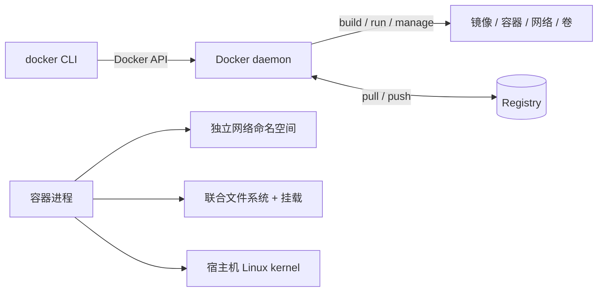

# Docker 基础概念

> [!summary] 一句话
> Docker 用镜像交付程序及其依赖，再把镜像作为隔离的宿主机进程运行，从而让同一套应用环境更容易构建、分发和复现。

返回：[[Docker 知识地图]]

## 它是什么

Docker 是一套构建、分发和运行容器化应用的平台。它至少包含以下几个可观察对象：

- **Docker Client**：`docker` 命令所在的一端，接收用户操作并调用 Docker API。
- **Docker daemon**：常称 `dockerd`，负责构建镜像、创建和运行容器、管理网络与卷。
- **Registry**：镜像仓库，例如 Docker Hub 或自建仓库；负责存储、检索和分发镜像。
- **Image**：只读的镜像模板，包含应用文件、运行时和启动元数据。
- **Container**：从镜像启动的可运行实例，拥有自己的进程视图、文件系统写入层和网络环境。

> [!note] 本机环境
> 当前 Mac 上尚未检测到 `docker` 命令。先安装 Docker Desktop 或连接可用的远程 Docker daemon，再执行本文命令。

## 为什么重要

它主要解决三类反复出现的问题：

1. **环境漂移**：开发机、CI 和生产环境的依赖版本不一致。
2. **交付粒度**：把应用、启动方式和必要依赖打包为一个可传输单元。
3. **本地编排**：用容器边界隔离 Web、数据库、缓存等组件，并快速重建。

容器不自动保证应用正确、数据安全或高可用。它提供的是可重复的打包与隔离边界。

## 心智模型



最值得记住的不是一条条命令，而是这条链：

```text
Dockerfile --build--> Image --run--> Container
                         ^ pull/push
                         |
                      Registry
```

容器不是一台上电即可长期存在的“小机器”。它通常围绕一个前台主进程运行；主进程退出，容器也随之退出。

## Docker 与虚拟机的区别

| 维度 | Docker 容器 | 传统虚拟机 |
| --- | --- | --- |
| 隔离单位 | 宿主机上的进程及其命名空间 | 完整的虚拟硬件与客户机操作系统 |
| 内核 | 与宿主机共享内核；Linux 容器使用 Linux kernel | 每个虚拟机运行自己的内核 |
| 启动速度 | 通常更快 | 通常更慢 |
| 资源开销 | 更小，但并非零 | 含完整系统运行开销 |
| 隔离强度 | 依赖内核、配置和宿主机安全边界 | 虚拟化边界通常更强 |

因此，不要把“容器”直接理解成“更快的虚拟机”。它是带隔离和资源控制的宿主进程。

## 关键对象

| 对象 | 你可以怎样理解 | 生命周期要点 |
| --- | --- | --- |
| Image | 只读模板、分层文件系统与启动配置 | 删除容器不会自动删除镜像 |
| Container | 镜像的一次运行实例 | 可停止、启动、重启、删除；删除后写入层消失 |
| Volume | Docker 管理的持久化存储 | 独立于容器生命周期，需主动删除 |
| Bind mount | 把宿主机路径映射进容器 | 内容与宿主机路径直接关联 |
| Network | 容器通信与 DNS 的边界 | 用户自定义 bridge 网络支持按名称解析 |
| Compose project | 一组关联 service/network/volume 的项目边界 | 同一文件可用不同项目名重复部署 |

更完整的关系见[[镜像与容器]]，持久化方式见[[Docker 存储与数据卷]]。

## 在 macOS 上如何运行

Docker Engine 原生运行在 Linux 上。Docker Desktop for Mac 会在虚拟机中运行 Linux Docker Engine，再由 macOS 侧提供 CLI、文件共享和网络转发。

这会带来一个重要的排错意识：

- 容器里的 `localhost` 指容器自己，不是你的 Mac。
- 从 Mac 访问容器，需要使用**发布的宿主机端口**，例如 `http://127.0.0.1:8080`。
- 宿主机路径能挂载进容器，是因为 Docker Desktop 做了跨虚拟机文件共享；大量小文件 I/O 仍可能比 Linux 宿主机慢。

### 安装后的最小检查

```bash
docker version
docker info
docker compose version
docker run --rm hello-world
```

预期意义：

- `docker version`：Client 与 Server 两端都可见。
- `docker info`：daemon 已启动，并能看到存储驱动、cgroup、资源和网络信息。
- `docker compose version`：Compose v2 插件可用。
- `hello-world`：完成一次镜像拉取、容器创建、进程运行和自动清理。

## 什么时候适合用 Docker

- 为本地开发提供可重建的数据库、缓存、消息队列等依赖。
- 将同一服务构建成可在 CI 与服务器之间传递的镜像。
- 在单机上组织多个相互隔离、通过网络协作的服务。
- 需要明确应用运行时依赖，减少“我这里能跑”的问题。

## 不适合直接解决什么

- 多主机高可用、自动扩缩容和复杂调度：通常交给 Kubernetes 等编排系统。
- 持久数据备份：Docker 只提供存储机制，数据库一致性备份仍需应用或数据库工具。
- 不可信代码的强沙箱：容器共享宿主内核，恶意代码隔离不能等同虚拟机。
- 用大量旁路进程维持一个“全能容器”：通常应拆分为多个服务。

## 常见误区

- **“容器删了镜像也没了”**：镜像和容器是不同对象。
- **“不写 `-v` 数据也会一直在容器里”**：删除容器时，其可写层也会删除。
- **“`EXPOSE` 会发布端口”**：`EXPOSE` 只是镜像元数据/文档提示；运行时的 `-p` 才发布端口。
- **“容器里的 `127.0.0.1` 就是宿主机”**：它指向容器自己的 loopback。
- **“能访问 Docker daemon 只是普通用户权限”**：daemon 能控制容器和宿主挂载，必须按高权限系统组件对待。

## 相关笔记

- 下一步：[[镜像与容器]]
- 网络：[[Docker 网络]]
- 持久化：[[Docker 存储与数据卷]]
- 安全边界：[[Docker 安全与权限]]
- 直接查命令：[[Docker 命令速查]]

## 来源

- Docker Docs, “Docker overview”: <https://docs.docker.com/get-started/docker-overview/>
- Docker Docs, “What is a container?”: <https://docs.docker.com/get-started/docker-concepts/the-basics/what-is-a-container/>
- Docker Docs, “Docker Desktop”: <https://docs.docker.com/manuals/desktop/>

核对日期：2026-10-27。版本相关细节请以你安装的 Docker Engine / Docker Desktop 对应文档为准。
