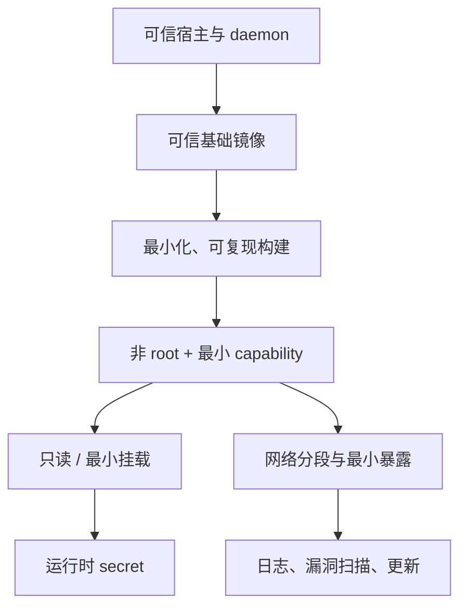

# Docker 安全与权限

> [!summary] 一句话
> 容器共享宿主内核，而 Docker daemon 又能控制挂载、网络和进程；安全工作的核心是限制 daemon 访问、缩小镜像与进程权限，并让秘密不进入镜像或日志。

返回：[[Docker 知识地图]]

## 它是什么

Docker 安全不是单个开关，而是一组边界：

```text
宿主内核与 daemon
  → 镜像来源与构建过程
    → 容器运行用户、capability、文件系统
      → 应用认证、网络与 secrets
```

容器通过 namespaces 隔离进程、网络和挂载视图，通过 control groups 管理资源。它不是完整虚拟机；宿主内核仍是重要攻击面。

## 为什么重要

Docker 默认配置通常比裸跑进程更有边界，但默认值不等于适合生产：

- 镜像可能包含 root 进程、构建工具、包管理器和多余软件。
- 容器可能错误挂载宿主敏感目录。
- `--privileged` 或过量 capabilities 会显著扩大权限。
- Docker daemon 可控制宿主资源，能访问它的人应按高权限用户管理。
- 环境变量、构建 ARG、镜像层和日志都可能泄漏秘密。
- 默认未发布的端口不应被误解为“服务绝对安全”；同一网络内的其他容器可能能访问。

## 心智模型



先问“这个进程真正需要什么”，再逐项授权；比先给高权限、出问题再收紧更容易保持一致。

## 1. 保护 Docker daemon

Docker daemon 是高权限系统组件。只有可信用户和自动化系统可以控制它。

原则：

- 不要无认证地把 daemon API 暴露到 TCP 网络。
- 不要在公网直接开放 `2375/tcp`。
- 如必须远程访问，使用受保护通道，例如 SSH context；若暴露 API，应使用官方支持的 TLS 双向认证。
- 不要把 daemon socket 挂进不受信任的容器。
- 将 daemon 配置和访问权限纳入系统变更管理与监控。

远程访问要优先考虑：

```bash
docker context create remote \
  --docker "host=ssh://user@host"
docker context use remote
```

具体 context 创建方式按你的 SSH 和 daemon 配置调整。

### Rootless 模式

Docker Engine 支持 rootless 模式，让 daemon 和容器以非 root 用户运行，以降低 daemon 被攻破后的影响。它不是万能隔离，也有网络、存储驱动和端口能力限制；应根据平台支持情况验证。

判断是否 rootless 时可查看：

```bash
docker info --format '{{json .SecurityOptions}}'
```

具体输出以版本和平台为准。

## 2. 运行时使用非 root

Dockerfile：

```dockerfile
FROM node:22-alpine
WORKDIR /app
COPY --chown=node:node . .
USER node
CMD ["node", "server.js"]
```

检查容器内实际用户：

```bash
docker run --rm IMAGE id
docker exec app id
```

注意：

- 创建文件时，容器用户需要对应目录的写权限。
- 数字 UID 在没有用户名的镜像中也可使用。
- 非 root 只是降低影响面，不等于应用没有漏洞。
- 某些基础镜像默认用户不同，应显式验证，而不是只看是否存在 `USER`。

## 3. 减少 capability 和特权

默认容器已经有受限的 Linux capabilities。能删除的通常应删除：

```bash
docker run --rm \
  --cap-drop=ALL \
  IMAGE
```

如果应用确实需要特定 capability，再逐项添加，例如仅需绑定低端口时才评估 `NET_BIND_SERVICE`。

禁止默认启用：

- `--privileged`
- `--pid=host`
- `--network=host`（除非有明确理由）
- 挂载宿主机 Docker socket
- 挂载宿主根目录、设备或敏感配置

这些选项都有适用场景，但应被视为高权限变更，而不是排错捷径。

## 4. 缩小文件系统写权限

应用只读仍可运行的话，优先使用只读根文件系统，并为确实需要的路径单独提供可写挂载：

```bash
docker run --rm \
  --read-only \
  --tmpfs /tmp:rw,noexec,nosuid,size=64m \
  --cap-drop=ALL \
  --security-opt no-new-privileges \
  --memory=512m \
  --cpus=1 \
  IMAGE
```

这套参数不是通用模板，必须用应用验证：

- 应用是否还需要写日志、缓存、PID 或上传目录？
- 这些写路径是否应该改为显式 tmpfs 或 volume？
- 镜像是否能以当前非 root 用户读取所需文件？
- 资源限制是否满足启动峰值？

`no-new-privileges` 禁止进程通过 setuid 等方式获得更多权限，可以降低部分提权路径，但不能修复应用漏洞。

## 5. 网络最小暴露

- 本地服务绑定宿主 loopback：`-p 127.0.0.1:8080:80`。
- 仅在容器间使用的端口不要发布给宿主。
- 按信任边界拆网络，例如 `front-tier` 与 `back-tier`。
- 对数据库网络使用 `internal: true`（仍需验证实际业务边界）。
- 默认网络中的容器可能互相访问，应把“同一 Docker 网络”也看作信任域。
- 对外入口使用反向代理、TLS、认证、限流和访问日志。

网络机制详见[[Docker 网络]]。

## 6. 秘密与配置

### 不要这样做

```dockerfile
ENV DATABASE_PASSWORD=real-password
RUN echo "$API_TOKEN" > /app/.token
```

```yaml
environment:
  DATABASE_PASSWORD: real-password
```

```bash
docker build --build-arg API_TOKEN=real-token .
```

风险：

- 可能被写入镜像层、镜像元数据、构建历史或日志。
- 可能进入 Compose 文件、Git 历史、进程环境和监控采集。
- 镜像可能被推到仓库后被他人拉取。

### BuildKit secret mount

```dockerfile
# syntax=docker/dockerfile:1
RUN --mount=type=secret,id=npm_token \
  NPM_TOKEN="$(cat /run/secrets/npm_token)" \
  npm ci
```

```bash
docker build \
  --secret id=npm_token,src="$HOME/.config/example/npm_token" \
  -t my-app:1.0.0 .
```

secret 只应在命令需要时短暂读取，不能复制到最终镜像或打印到构建日志。

### Compose secrets

```yaml
services:
  app:
    secrets:
      - db_password

secrets:
  db_password:
    file: ./secrets/db_password.txt
```

容器通常从 `/run/secrets/db_password` 读取。Compose 在单机与 Swarm 下的实现存在差异，文件权限和挂载语义应按平台验证。

开发用 `.env` 便于本地配置，但它不是生产密钥管理方案。

## 7. 镜像供应链

- 优先使用维护活跃、来源可信的官方或认证镜像。
- 使用具体版本标签；高复现要求下评估 digest。
- 定期用 `--pull` 重建，以获取安全补丁。
- 不安装无关包，不在最终镜像留下编译器和源码。
- 使用多阶段构建减少运行镜像攻击面。
- 扫描漏洞并建立修复时限，而不是只看“是否扫描过”。

如果环境安装了 Docker Scout，可使用：

```bash
docker scout quickview IMAGE
docker scout cves IMAGE
```

可用性和功能取决于你的 Docker 产品、认证与订阅状态。

## 8. 资源限制

资源限制既防止异常应用拖垮宿主，也降低简单资源耗尽风险：

```bash
docker run --rm \
  --memory=512m \
  --memory-swap=512m \
  --cpus=1 \
  --pids-limit=200 \
  IMAGE
```

在 Compose 中应使用当前 Compose 规范支持的资源字段，并用 `docker compose config` 检查实际解析结果。不要凭记忆复制旧版 `deploy.resources` 片段而不验证平台。

## 安全检查清单

- [ ] daemon 只允许可信用户/主机访问，远程通道受保护。
- [ ] 镜像来源、标签和更新策略明确。
- [ ] 运行用户是非 root，且只拥有必要文件权限。
- [ ] 移除了不需要的 capabilities，没有无理由使用 `--privileged`。
- [ ] 挂载路径最小化，宿主敏感目录未暴露为读写。
- [ ] 只发布必要端口，本地端口优先绑定 `127.0.0.1`。
- [ ] 秘密不进入镜像、Dockerfile、ARG、Compose 文件和日志。
- [ ] 已配置资源上限和日志轮转。
- [ ] 已建立漏洞扫描、补丁和镜像重建流程。
- [ ] 重要数据有独立备份和恢复演练。

## 常见误区

- **“容器里是 root 也没关系，因为已经隔离”**：root 仍可利用内核、错误挂载或过度 capability 扩大影响。
- **“内部网络就不用认证”**：网络内也可能有被攻陷的其他容器。
- **“环境变量比明文文件安全”**：它可以减少误提交，但仍可能被进程、日志和检查工具捕获。
- **“构建参数不是镜像内容”**：构建历史、日志和层都可能泄漏。
- **“扫描通过就没有漏洞”**：扫描覆盖范围、规则时效和运行时配置都会影响结论。

## 相关笔记

- 镜像构建：[[Dockerfile 与镜像构建]]
- 网络边界：[[Docker 网络]]
- 数据存储：[[Docker 存储与数据卷]]
- 安全事件排错：[[Docker 故障排查]]
- 返回：[[Docker 知识地图]]

## 来源

- Docker Docs, “Docker Engine security”: <https://docs.docker.com/engine/security/>
- Docker Docs, “Rootless mode”: <https://docs.docker.com/engine/security/rootless/>
- Docker Docs, “Building best practices”: <https://docs.docker.com/build/building/best-practices/>
- Docker Docs, “Use secrets in Compose”: <https://docs.docker.com/compose/how-tos/use-secrets/>
- Docker Docs, “Dockerfile RUN --mount=type=secret”: <https://docs.docker.com/reference/dockerfile/#run---mounttypesecret>

核对日期：2026-10-27。策略性建议与官方机制已分开描述；安全参数必须结合具体镜像和应用验证。
