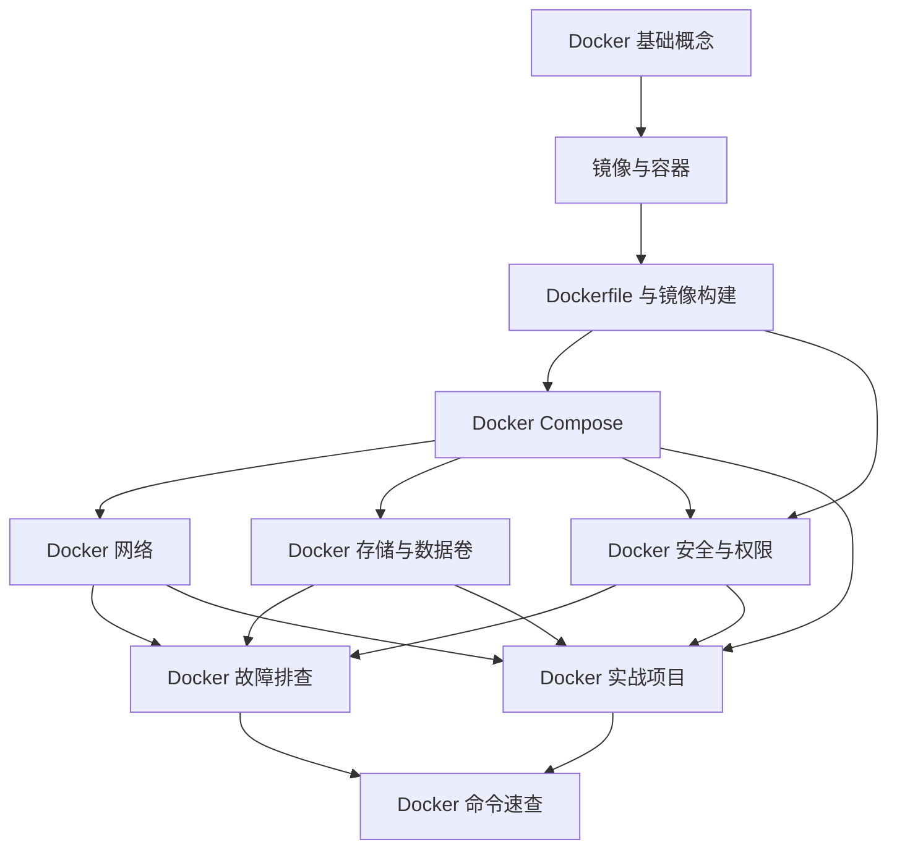

# Docker 知识地图

> [!summary] 主题定位
> 从“容器到底是什么”出发，掌握用 Dockerfile 构建镜像、用 Compose 组织多容器应用，以及网络、持久化、安全和排错这套可以落地的开发闭环。

返回：[[开发知识库]]

> [!info] 当前学习深度
> 面向已经会使用命令行、希望达到实用中级水平的学习者。内容核对日期为 2026-10-27。知识体系偏重本地开发与单机部署；Kubernetes、集群调度只作为边界概念，不在本图中展开。

## 先建立一句话模型

Docker 把一个程序及其运行依赖封装进**镜像**，启动镜像得到一个**容器进程**；多个容器通过**网络**协作，通过**挂载**持久化数据，再由 **Compose** 编排成一套应用。

## 推荐学习路线

### 路线 A：第一次系统学习

1. [[Docker 基础概念]]：先分清 client、daemon、镜像、容器和 registry。
2. [[镜像与容器]]：理解“模板”和“运行实例”的生命周期。
3. [[Dockerfile 与镜像构建]]：把应用可靠地构建成镜像。
4. [[Docker Compose]]：用一个文件组织应用、数据库和依赖关系。
5. [[Docker 网络]]与[[Docker 存储与数据卷]]：解决“怎么连”和“数据放哪”。
6. [[Docker 安全与权限]]：知道容器隔离的边界，收紧默认权限。
7. [[Docker 故障排查]]：掌握从状态、日志到网络和资源的排错顺序。
8. [[Docker 实战项目]]：完成一个可启动、可验证、可清理的 Compose 项目。

### 路线 B：带着问题查

| 我现在要做什么 | 先读 |
| --- | --- |
| 第一次运行容器 | [[Docker 基础概念]] → [[Docker 命令速查]] |
| 给自己的应用做镜像 | [[Dockerfile 与镜像构建]] |
| 同时启动 Web 和数据库 | [[Docker Compose]] |
| 容器之间无法访问 | [[Docker 网络]] → [[Docker 故障排查]] |
| 删除容器后数据丢失 | [[Docker 存储与数据卷]] |
| 降低容器权限和密钥泄漏风险 | [[Docker 安全与权限]] |
| 容器启动后马上退出 | [[Docker 故障排查]] |
| 完整练习一套项目 | [[Docker 实战项目]] |

## 知识结构

## 核心概念

- [[Docker 基础概念]]：Docker 的架构心智模型、适用边界、macOS 上的运行方式。
- [[镜像与容器]]：分层镜像、容器生命周期、标签与 digest、常见对象操作。

## 构建与编排

- [[Dockerfile 与镜像构建]]：构建上下文、指令选择、多阶段构建、缓存与安全。
- [[Docker Compose]]：service、project、依赖顺序、环境变量与生命周期。

## 连接与数据

- [[Docker 网络]]：bridge、DNS、端口发布、网络隔离与诊断。
- [[Docker 存储与数据卷]]：volume、bind mount、tmpfs、备份与权限。

## 生产意识

- [[Docker 安全与权限]]：daemon 权限边界、非 root、capability、只读文件系统与密钥。

## 查询与实践

- [[Docker 命令速查]]：按对象分类的高频命令和危险操作提醒。
- [[Docker 故障排查]]：症状驱动的诊断树。
- [[Docker 实战项目]]：Node.js + PostgreSQL 的端到端 Compose 示例。

## 学完后应能回答

1. 为什么容器不是“轻量虚拟机”？镜像与容器分别处于什么生命周期？
2. 为什么 Dockerfile 的层顺序会影响缓存？多阶段构建解决了什么问题？
3. 为什么浏览器访问宿主机端口，而容器之间使用服务名和容器端口？
4. 为什么 `docker compose down` 与 `docker compose down -v` 的风险不同？
5. 为什么能执行 `docker` 的人通常拥有很高的宿主机权限？

## 学习状态与环境说明

- 内容层级：实用中级。
- 首发范围：11 篇笔记，保持可读的原子主题，不按每个命令拆碎。
- 本机状态：2026-10-27 检查时，`/Users/gao/sweetsunnyflower` 中尚无 Docker 专题；当前 shell 也未找到 `docker` 命令。
- 运行声明：笔记中的命令来自官方文档语法与常用实践，但本机尚未实际执行 Docker 示例。安装并启动 Docker 后，建议从 [[Docker 实战项目]] 的验证清单开始逐项确认。

## 来源

- Docker Docs, “Docker overview”: <https://docs.docker.com/get-started/docker-overview/>
- Docker Docs, “Build with Docker”: <https://docs.docker.com/build/>
- Docker Docs, “Docker Compose”: <https://docs.docker.com/compose/>
- Docker Docs, “Docker Engine”: <https://docs.docker.com/engine/>

核对日期：2026-10-27。
