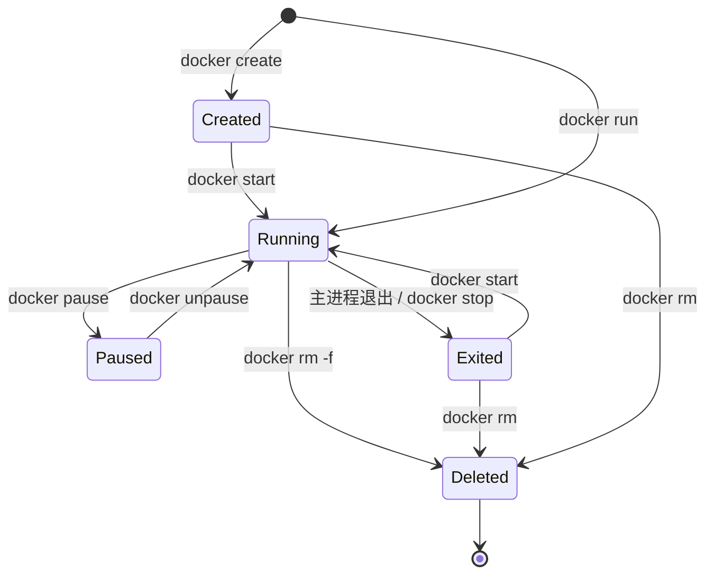

# 镜像与容器

> [!summary] 一句话
> 镜像是只读的应用模板，容器是镜像的一次运行实例；容器可写层随容器删除而消失，持久数据必须放到卷或宿主机挂载中。

返回：[[Docker 知识地图]]

## 它是什么

### 镜像

镜像是一组按层组织的只读文件系统与运行元数据。运行元数据包括默认命令、入口点、环境变量、工作目录、暴露端口和健康检查等。

镜像有几个重要属性：

- **不可变**：镜像构建完成后本身不改变；重新构建会生成新的镜像记录。
- **分层**：Dockerfile 中会创建文件系统变化的指令通常形成一层，层可复用。
- **可标记**：一个镜像可以有多个标签。
- **可定位**：标签可被重新指向别的内容，digest 则指向确定内容。

### 容器

容器是镜像的运行实例。Docker 为它创建进程、网络、挂载和隔离视图，并在只读镜像层之上增加一个可写层。

容器通常有一个主进程。主进程以什么身份运行、收到什么信号、退出状态是什么，直接影响容器行为。

## 为什么重要

很多 Docker 问题其实是在混淆三层生命周期：

```text
镜像仓库中的 tag
    ↓ pull
本机镜像
    ↓ run
容器可写层与进程
    ↓ rm
容器消失
```

理解这三层后，才能正确判断“更新的是什么”“为什么重启后文件没变”“为什么删了容器数据还在或不在”。

## 心智模型



`docker stop` 先发送停止信号，超时后再强制终止；`docker kill` 默认直接发送 `SIGKILL`。因此，应用能否优雅关闭，取决于它如何接收并处理 `SIGTERM`。

## 标签与 digest

标签是方便人阅读的别名，例如：

```text
my-app:1.4.0
postgres:18-alpine
```

标签可能被重新指向；digest 则精确锁定镜像内容：

```text
my-registry.example.com/team/my-app@sha256:<digest>
```

实践取舍：

- 开发和探索可以先用可读标签。
- 需要可重复构建时，锁定更具体的版本，必要时再加 digest。
- 不要为了“看起来最新”在所有地方机械使用 `latest`。

## 常用操作示例

### 拉取并运行

```bash
docker pull nginx:1.27-alpine
docker run -d \
  --name demo-web \
  -p 127.0.0.1:8080:80 \
  nginx:1.27-alpine
```

访问宿主机 `http://127.0.0.1:8080`。这里的映射方向是：

```text
宿主机 127.0.0.1:8080 -> 容器 80/tcp
```

端口绑定到 `127.0.0.1`，比默认绑定到所有宿主接口更不容易意外暴露给局域网。

### 观察容器

```bash
docker ps
docker logs --tail 100 demo-web
docker inspect demo-web
docker stats --no-stream demo-web
docker exec -it demo-web sh
```

`exec` 进入的是运行中的容器；容器内修改通常只在当前可写层存在。

### 停止、重启与删除

```bash
docker stop demo-web
docker start demo-web
docker restart demo-web
docker rm -f demo-web
docker rmi nginx:1.27-alpine
```

如果镜像仍被容器引用，删除镜像可能失败；先检查 `docker ps -a`。

### 从容器生成镜像

```bash
docker commit demo-web my-nginx:manual
```

`docker commit` 适合一次性检查或救急，不应代替可审计的 Dockerfile。提交后的镜像缺少明确的构建来源，且难以稳定复现。

## 可写层与持久化

启动容器时，Docker 在镜像只读层之上叠加可写层。写入容器的数据默认进入这个层。

- 停止再启动同一容器：可写层仍属于该容器。
- 删除容器：可写层随之删除。
- 使用 volume 或 bind mount：数据存在容器生命周期之外。

持久化选择见[[Docker 存储与数据卷]]。

## 镜像层与缓存

可以把镜像理解为一摞层：

```text
基础镜像层
  + 安装依赖层
  + 复制源码层
  + 构建产物层
  = 最终镜像
```

Dockerfile 中某层的输入变化时，该层及后续层可能失效。这正是“先复制依赖清单、再安装依赖、最后复制源码”的原因。详见[[Dockerfile 与镜像构建]]。

## 常见误区

- **标签没变就代表内容没变**：标签可被重新指向。
- **同一个镜像运行两个容器会互相修改文件**：容器各有自己的可写层。
- **容器重启就恢复镜像初始状态**：停止/启动不会丢掉当前容器的可写层。
- **删除容器就自动删除所有关联数据**：命名卷默认不会随容器删除。
- **`docker exec` 成功就说明应用健康**：它只能说明容器主进程还在运行，不代表端口、依赖或健康检查正常。

## 排错时先看什么

```bash
docker ps -a
docker logs <container>
docker inspect <container>
docker diff <container>
```

重点观察：

- 状态是 `running`、`exited`，还是不断重启？
- 退出码和 `OOMKilled` 是什么？
- 主进程命令是否符合预期？
- 日志是否能解释退出原因？
- 文件和挂载是否覆盖了原本的应用路径？

诊断顺序见[[Docker 故障排查]]。

## 相关笔记

- 前置：[[Docker 基础概念]]
- 构建镜像：[[Dockerfile 与镜像构建]]
- 持久化：[[Docker 存储与数据卷]]
- 端口与容器互访：[[Docker 网络]]
- 常用命令：[[Docker 命令速查]]
- 返回：[[Docker 知识地图]]

## 来源

- Docker Docs, “What is an image?”: <https://docs.docker.com/get-started/docker-concepts/the-basics/what-is-an-image/>
- Docker Docs, “What is a container?”: <https://docs.docker.com/get-started/docker-concepts/the-basics/what-is-a-container/>
- Docker Docs, “docker container”: <https://docs.docker.com/reference/cli/docker/container/>

核对日期：2026-10-27。示例未在当前机器运行，因为当前环境未检测到 `docker` 命令。
