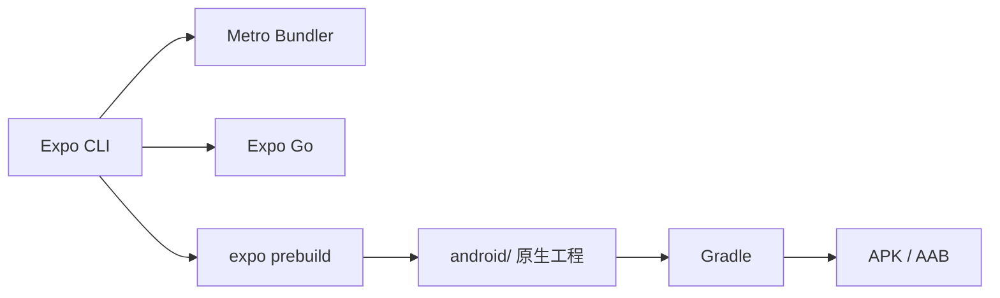

# Expo 环境搭建

> [!success] 当前状态
> 本机已完成 Expo Android 开发环境配置，并通过 `expo-doctor` 和 Gradle Debug 构建验证。无需安装 Android Studio。

关联入口：[[Expo 知识地图]] · [[开发知识库]]

## 1. 环境概览

| 组件 | 当前版本/路径 |
|---|---|
| macOS | 26.5.2，Apple Silicon arm64 |
| Node.js | 22.23.4 LTS |
| npm | 10.9.9 |
| JDK | OpenJDK 17 |
| Android SDK | `/opt/homebrew/share/android-commandlinetools` |
| Android Platform | 35 / 36 / 37 |
| Build Tools | 35.0.0 / 36.0.0 / 37.0.0 |
| NDK | 27.1.12297006 |
| CMake | 3.22.1 |
| Android Emulator | 37.2.12 |
| Watchman | 2026.10.19.00 |
| Expo SDK | 58 |

详细组件含义见 [[Android SDK 组件说明]]。

## 2. 整体结构



Expo 与 React Native 的关系见 [[Expo 与 React Native 的关系]]；三种运行方式的区别见 [[Expo Go、开发构建与 EAS Build]]。

## 3. 安装步骤

### 3.1 Node.js

使用 Node 22 LTS，不建议直接用非 LTS 的最新版。

```bash
brew install node@22
export PATH="/opt/homebrew/opt/node@22/bin:$PATH"
node -v
npm -v
```

版本管理细节见 [[Node.js 与 Expo 版本管理]]。

### 3.2 Java

Expo/Android Gradle 构建使用 JDK 17：

```bash
export JAVA_HOME="/opt/homebrew/opt/openjdk@17/libexec/openjdk.jdk/Contents/Home"
java -version
```

### 3.3 Android SDK

```bash
brew install --cask android-commandlinetools android-platform-tools

export ANDROID_HOME="/opt/homebrew/share/android-commandlinetools"
export ANDROID_SDK_ROOT="$ANDROID_HOME"

sdkmanager \
  "platforms;android-35" \
  "platforms;android-36" \
  "build-tools;35.0.0" \
  "build-tools;36.0.0"
```

Expo SDK 58 实际构建时还会自动安装 `platforms;android-37.0`、`build-tools;37.0.0`、NDK 27.1 和 CMake 3.22.1。

### 3.4 shell 配置

在 `~/.zshrc` 中加入：

```bash
export ANDROID_HOME="/opt/homebrew/share/android-commandlinetools"
export ANDROID_SDK_ROOT="$ANDROID_HOME"
export JAVA_HOME="/opt/homebrew/opt/openjdk@17/libexec/openjdk.jdk/Contents/Home"
export PATH="$ANDROID_HOME/platform-tools:$ANDROID_HOME/emulator:$ANDROID_HOME/cmdline-tools/latest/bin:$PATH"
export PATH="/opt/homebrew/opt/node@22/bin:$PATH"
```

重新加载：

```bash
source ~/.zshrc
```

### 3.5 Watchman

```bash
brew install watchman
watchman --version
```

## 4. 创建项目

```bash
npx create-expo-app@latest my-app --template blank-typescript
cd my-app
```

当前验证项目位于 `/Users/gao/wechat/expo-check`。

## 5. 三种运行方式

| 方式 | 命令 | 需要本地 Android SDK | 适用场景 |
|---|---|---|---|
| Expo Go | `npx expo start` | 否 | 快速预览、纯 JS/TS 项目 |
| 本地开发构建 | `npx expo run:android` | 是 | 使用原生模块、调试原生代码 |
| EAS 云构建 | `eas build -p android` | 否 | 生成 APK/AAB、CI 构建 |

详细对比见 [[Expo Go、开发构建与 EAS Build]]。

```bash
# 启动 Metro，手机 Expo Go 扫码
npx expo start

# 连接 Android 真机或模拟器后本地安装
npx expo run:android
```

## 6. 本地 Android 构建

```bash
npx expo prebuild --platform android --no-install
cd android
./gradlew assembleDebug
```

生成文件：

```text
android/app/build/outputs/apk/debug/app-debug.apk
```

本机验证结果：`BUILD SUCCESSFUL`，APK 约 140MB。记录见 [[本次 Expo 环境搭建记录 2026-10-27]]。

## 7. 国内 Gradle 镜像

Expo prebuild 生成的 `android/build.gradle` 默认使用：

```groovy
google()
mavenCentral()
maven { url 'https://www.jitpack.io' }
```

国内网络下可以在前面加入阿里云镜像：

```groovy
maven { url 'https://maven.aliyun.com/repository/google' }
maven { url 'https://maven.aliyun.com/repository/central' }
maven { url 'https://maven.aliyun.com/repository/gradle-plugin' }
maven { url 'https://maven.aliyun.com/repository/public' }
```

完整说明和注意事项见 [[Gradle 国内镜像配置（Expo Android）]]。

## 8. 验证清单

- [x] `node -v` 为 Node 22 LTS
- [x] `java -version` 为 JDK 17
- [x] `ANDROID_HOME` 路径正确
- [x] `adb devices` 可用
- [x] `emulator -version` 可用
- [x] `npx expo-doctor` 通过
- [x] Gradle Debug 构建成功
- [x] 已生成 APK

## 9. 常见问题

遇到问题先看 [[Expo 故障排查]]，高频问题包括：

- `ANDROID_HOME` 路径错误
- 缺少 Platform/Build Tools
- `emulator: command not found`
- Gradle 下载慢
- Expo Go 与项目 SDK 不兼容
- 真机连接或无线 ADB 掉线

## 10. 关联笔记

- [[Expo 知识地图]]
- [[Expo 与 React Native 的关系]]
- [[Expo Go、开发构建与 EAS Build]]
- [[Android SDK 组件说明]]
- [[Node.js 与 Expo 版本管理]]
- [[Gradle 国内镜像配置（Expo Android）]]
- [[Expo 常用命令]]
- [[Expo 故障排查]]
- [[本次 Expo 环境搭建记录 2026-10-27]]
