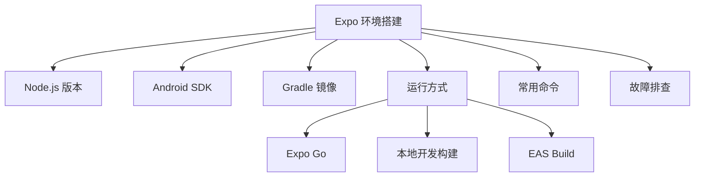

# Expo 知识地图

> [!info] 定位
> 这是 Expo 相关笔记的入口。主流程从 [[Expo 环境搭建]] 开始，遇到问题查 [[Expo 故障排查]]。

## 入门

- [[Expo 环境搭建]]
- [[Expo 与 React Native 的关系]]
- [[Expo Go、开发构建与 EAS Build]]

## 环境与工具

- [[Node.js 与 Expo 版本管理]]
- [[Android SDK 组件说明]]
- [[Gradle 国内镜像配置（Expo Android）]]

## 日常使用

- [[Expo 常用命令]]
- [[Expo 故障排查]]

## 实践记录

- [[本次 Expo 环境搭建记录 2026-10-27]]

## 关系图

